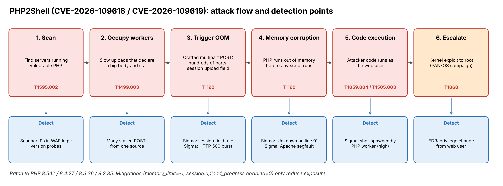

# PHP2Shell (CVE-2026-109618 / CVE-2026-109619): Detection Engineering & Response

> Portfolio project: detection rules, a response playbook and a MITRE ATT&CK mapping for PHP2Shell, the two critical PHP flaws that made governments across Europe take websites offline in October 2026.
>
> **Framework version:** MITRE ATT&CK Enterprise v20.1 · **Rule format:** Sigma (validated and converted with pySigma) · **Analysis date:** 21 November 2026

## 1. Executive summary

On 21 October 2026 the PHP project fixed two critical flaws in the PHP engine itself, CVE-2026-109618 and CVE-2026-109619 (CVSS v4.0 9.2 each), together called PHP2Shell.
Both allow unauthenticated remote code execution with a single crafted request, before any application code runs, so even a "Hello World" page on a vulnerable version can be exposed.
The flaws were found with AI-assisted research by Calif, Wiz and OpenAI. When the CVE IDs leaked a day early, CERT-EU advised isolating sites that could not be patched, and government services in Germany, France, the Netherlands, Denmark and Finland went offline as a precaution.
Exploitation attempts started before disclosure (17 October), CISA added both CVEs to its Known Exploited Vulnerabilities catalog on 26 October, and attackers chained PHP2Shell with a Linux kernel flaw to gain root on internet-exposed PAN-OS management interfaces.
**This project** turns the public research into six Sigma detection rules (with Splunk versions), a patch-or-isolate response playbook and an ATT&CK mapping. **Key lesson:** when a flaw sits below the application, the most reliable detections are generic ones, such as a shell spawned by a PHP worker, not signatures of one exploit.

## 2. Timeline

| Date (2026) | Event | Source |
| --- | --- | --- |
| 11 August | Calif reports an unconditional RCE to the PHP security team | WWT, Sansec |
| 19–24 August | Wiz finds the bug, confirms RCE on Drupal and WordPress, reports it | WWT |
| August–18 September | Calif, Wiz and OpenAI independently report the same out-of-memory root cause | PHP Foundation via CSA |
| 17 October | Amazon Threat Intelligence sees an exploitation attempt on its honeypots, four days before disclosure | Tenable (citing Amazon) |
| 20 October | CVE IDs leak; release moved forward; CERT-EU advisory 2026-018 | Tenable, CERT-EU |
| 21 October | PHP releases 8.5.12, 8.4.27, 8.3.36 and 8.2.35; European government sites go offline as a precaution; Cloudflare reports early attacks | PHP, CERT-EU, Reuters |
| 23 October | PHP publishes an advisory on a third, unlikely vector, CVE-2026-115560 | Tenable, CERT-EU |
| 24 October | Successful exploitation of three PHP 8.4.26 honeypots reported | Tenable (citing Adel Karimi) |
| 26 October | CISA adds both CVEs to KEV (federal deadline 29 October); Trail of Bits confirms working exploits for PHP 8.2–8.5 | Tenable |
| 29 October | Unit 42 confirms a campaign chaining PHP2Shell with a Linux kernel flaw against exposed PAN-OS management interfaces | Unit 42 |
| 19 November | PHP releases fixes for 18 more vulnerabilities, seven rated critical | Unit 42 |

## 3. How the attack works (in plain words)

1. **Out-of-memory as a weapon (CVE-2026-109618).** PHP stops a request with `longjmp()` when it goes over `memory_limit`. If that happens while PHP is still parsing the request (for example a form-based file upload), internal data is left half built, and the cleanup code later treats it as valid. That corrupts memory.
2. **Leftover state (CVE-2026-109619).** State that belongs to one request can survive after its memory is freed, and a later request on the same worker can use it. PHP's advisory links this to the session upload-progress feature, which is enabled by default and runs even if the application never starts a session.
3. **In practice.** Captured attempts open slow uploads to occupy other workers, then send multipart POSTs with hundreds of parts, deeply nested field names, large padding fields, a `PHP_SESSION_UPLOAD_PROGRESS` field and a strange `PHPSESSID` (a null byte or one character). The memory-exhaustion stage returns HTTP 500.

**Affected:** PHP 8.5 < 8.5.12, 8.4 < 8.4.27, 8.3 < 8.3.36, 8.2 < 8.2.35, and 8.1 and older (source backports only for 7.4–8.1; nothing for 5.4–7.3). All web SAPIs: PHP-FPM, Apache `mod_php` (highest risk), `php-cgi`, FrankenPHP, LiteSpeed, plus products that embed PHP.

## 4. MITRE ATT&CK Enterprise mapping

| # | Phase | Technique | Status | Evidence |
| --- | --- | --- | --- | --- |
| 1 | Scanning | T1595.002 Vulnerability Scanning | Observed | Scanner IPs alongside exploit attempts (Wiz); attempts before disclosure (Amazon) |
| 2 | Occupy workers | T1499.003 Application Exhaustion Flood | Partial | Stalled uploads that declare 1 MB and send one byte, used as a step, not as the goal |
| 3 | Exploit | T1190 Exploit Public-Facing Application | Observed | Unauthenticated RCE in the PHP engine; KEV listing; honeypot exploitation |
| 4 | Leak secrets | T1212 Exploitation for Credential Access | Reported | The memory-disclosure path can return passwords, tokens and keys from other requests without code execution (Wiz) |
| 5 | Run commands | T1059.004 Unix Shell | Expected | Commands run as the web user after RCE; hunt for shells under PHP workers |
| 5 | Plant code | T1505.003 Web Shell | Expected | Session-poisoning tooling plants PHP code in session data |
| 5 | Download tools | T1105 Ingress Tool Transfer | Expected | Download utilities started by PHP workers |
| 6 | Get root | T1068 Exploitation for Privilege Escalation | Observed (PAN-OS) | PHP2Shell chained with a Linux kernel flaw (Dream Research, verified by Unit 42) |

_Navigator layer: [`layers/attack-layer.json`](layers/attack-layer.json) (open it in the [ATT&CK Navigator](https://mitre-attack.github.io/attack-navigator/))_

## 5. Detection rules

All rules are in [`detections/sigma/`](detections/sigma/), validated with pySigma. Splunk versions are in [`detections/splunk_queries.md`](detections/splunk_queries.md).

| Rule | Data source | What it catches | Confidence |
| --- | --- | --- | --- |
| [Shell or download tool spawned by PHP worker](detections/sigma/php2shell_webserver_spawns_shell.yml) | Linux process creation (EDR, auditd, Sysmon for Linux) | Post-exploitation: `sh`, `bash`, `curl`, `wget`, `nc` under `apache2`, `httpd` or `php-fpm` | **High** (generic, survives exploit changes) |
| [Memory exhaustion during request initialisation](detections/sigma/php2shell_php_oom_during_request_init.yml) | PHP error log | "Allowed memory size ... exhausted" at "Unknown on line 0", the failure the exploit needs | Medium |
| [Upload filename with PHP code or serialized object](detections/sigma/php2shell_upload_filename_with_php_code.yml) | WAF / reverse proxy with body logging | `<?php` or `\|O:` in upload filenames (session poisoning) | High |
| [Multipart request with session upload-progress field](detections/sigma/php2shell_multipart_session_upload_progress.yml) | WAF / reverse proxy with body logging | `PHP_SESSION_UPLOAD_PROGRESS` + `PHPSESSID` in a multipart POST | Medium (legitimate forms use it) |
| [Burst of HTTP 500 to POSTs from one source](detections/sigma/php2shell_multipart_500_burst.yml) | Web server access log | Two or more POST → 500 from one IP to one host within a minute (Sigma correlation rule) | Low alone, useful for correlation |
| [Apache worker segmentation fault](detections/sigma/php2shell_apache_worker_segfault.yml) | Apache error log | `AH00052 ... Segmentation fault` from failed attempts | Low alone (successful variants may not crash) |

**How to use them together:** no single signal is conclusive. Raise an incident when a memory-exhaustion error and a session-field or HTTP 500 hit come from the same host within minutes, and treat any shell under a PHP worker as an incident on its own.

**Hunting ideas without rules:** many connections that declare a large `Content-Length` and send almost nothing; `Set-Cookie: PHPSESSID=` values that are unusually long, percent-encoded or binary; repeated PHP-FPM worker restarts; GET requests carrying session file paths in parameters.

## 6. Response playbook (patch or isolate)

| Step | Action | Notes |
| --- | --- | --- |
| 1. Inventory | Find every PHP runtime that serves HTTP: servers, containers, appliances and products that embed PHP | The CLI `php -v` may differ from the web runtime; vendors may backport fixes without changing the version string |
| 2. Patch | Upgrade to 8.5.12 / 8.4.27 / 8.3.36 / 8.2.35 or the vendor backport; rebuild images; restart **every** worker | The only complete fix |
| 3. Can't patch today? | Isolate internet-facing apps (CERT-EU) or take them offline, as several governments did | Downtime vs exposure is a business decision; document who accepted the risk |
| 4. Temporary mitigations | CVE-2026-109618: `memory_limit=-1` set by the administrator, plus request-size limits at the proxy and container memory limits. CVE-2026-109619: `session.upload_progress.enabled=0` in `php.ini` or the FPM pool, then restart workers; on PHP 8.5 also `fatal_error_backtraces=0` | Reduce exposure only; do not use `RLIMIT_AS`/`RLIMIT_DATA`; `ini_set()` and `.user.ini` are too late |
| 5. Virtual patch | WAF or reverse-proxy rules on part count, field-name nesting and body size | Check that the WAF sees full and chunked bodies |
| 6. Hunt | Run the Sigma rules back to **17 October**, the first known attempt | Pre-disclosure exploitation means "patched on day 1" does not mean "not compromised" |
| 7. If compromised | Rotate secrets the PHP process could read (the memory leak path exposes them without code execution); rebuild the host; check for web shells and new privileged accounts | On appliances such as PAN-OS, follow the vendor's incident guidance |

## 7. Indicators (use with care)

Wiz published IP addresses seen in exploitation attempts and scanning between 21 and 26 October 2026: `85.11.187.35`, `3.37.227.134`, `172.206.2.199`, `103.151.172.95`, `178.249.214.6`, `15.204.59.70`, `162.35.99.94`, `135.136.19.197`, and `31.56.197.72` (listed as a payload server).
Several are VPN exits or cloud hosts and some attempts used unrelated tooling, so treat them as hunting leads, not blocklist-grade indicators. They will age quickly.

## 8. Open questions & limitations

- **The rules are untested against live exploit traffic.** They follow published research (Datadog, Wiz, CERT-EU, Unit 42) and pass pySigma validation, but have not been run against a real attack in a lab. Field names must be mapped to each environment.
- **Which CVE is the session path?** Wiz files both of its bugs under CVE-2026-109618, while PHP's advisory ties the session upload-progress path to CVE-2026-109619. Some early write-ups blamed a session use-after-free that later testing did not reproduce as the root cause. The rules therefore target the shared behaviour, not one CVE.
- **Exposure numbers vary widely:** about 1.3 million potentially vulnerable hosts (Silas Cutler), over 1.9 million hosts running PHP (Shodan) and over 22.6 million potentially vulnerable instances (Cortex Xpanse). They measure different things.
- **A retracted attribution.** Unit 42 first linked post-compromise activity at a European government agency to PHP2Shell, then retracted it on 25 October because it could not confirm the initial access. No public, confirmed compromise of a European government through PHP2Shell is known.
- **Mitigations are partial.** PHP says updating is the only safe choice; `memory_limit=-1` also lets an attacker exhaust host memory.
- **Body-based rules need body logging.** Most web servers do not log request bodies, so two rules require a WAF or reverse proxy that does.
- **More PHP flaws.** The 19 November release fixed 18 more vulnerabilities (CVE-2026-115560 among the earlier ones). They are out of scope here.

## 9. Sources

- [CERT-EU Security Advisory 2026-018: Critical Vulnerabilities in PHP](https://cert.europa.eu/publications/security-advisories/2026-018)
- [Datadog Security Labs: PHP2Shell detection, analysis and remediation](https://securitylabs.datadoghq.com/articles/php2shell-critical-vulnerabilities-in-php/)
- [Wiz: PHP2Shell exploitation attempts and remediation trends](https://www.wiz.io/blog/php2shell-exploitation-so-far)
- [Unit 42: Threat Brief, Critical Vulnerabilities in PHP (updated 19 Nov)](https://unit42.paloaltonetworks.com/cve-2026-109618-cve-2026-109619/)
- [Tenable: php2shell FAQ](https://www.tenable.com/blog/php2shell-cve-2026-109618-cve-2026-109619-frequently-asked-questions-about-critical-php-remote)
- [Rapid7: Critical unauthenticated RCE in PHP](https://www.rapid7.com/blog/post/etr-cve-2026-109618-and-cve-2026-109619-critical-unauthenticated-remote-code-execution-in-php/)
- [WWT: PHP2Shell, exploitation before disclosure](https://www.wwt.com/blog/php2shell-exploitation-before-disclosure-a-technical-reference)
- [Cloud Security Alliance: PHP2Shell research note](https://labs.cloudsecurityalliance.org/research/csa-research-note-php2shell-pre-disclosure-exploitation-2026/)
- [The Next Web: European governments pull websites offline over two critical PHP flaws](https://thenextweb.com/news/europe-governments-websites-offline-php-security-flaws)
- [MITRE ATT&CK](https://attack.mitre.org) · [Sigma](https://github.com/SigmaHQ/sigma) · [pySigma](https://github.com/SigmaHQ/pySigma)

## License & attribution

© 2026 Stelios Partsinevelos. Released under the MIT License (see [LICENSE](LICENSE)).

MITRE ATT&CK® is a registered trademark of The MITRE Corporation; ATT&CK content © The MITRE Corporation. This project is not affiliated with or endorsed by MITRE, the PHP project or any vendor named. The detection rules are provided as-is for defensive use; test them before production.
